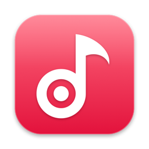
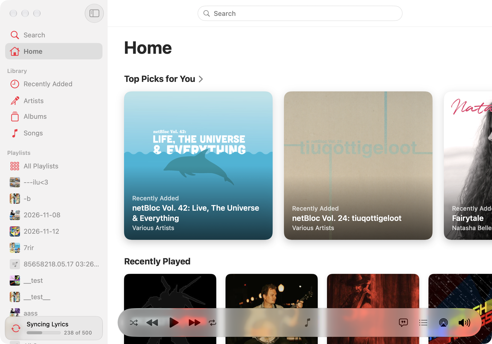

<p align="center"></p>

<h1 align="center">MusicSync</h1>

<p align="center">Native macOS app that syncs a Navidrome / OpenSubsonic library to an iPod classic.</p>



## Features

- Browse and play your server library in an Apple Music–style window, with lyrics and a play queue.
- Fast local mirror of the library, so search works at once, also offline.
- Sync albums, artists and playlists to an iPod classic with stock firmware: own iTunesDB writer with hash58, covers, playlists, gapless playback and Sound Check.
- Converts lossless files to AAC with Apple's encoder; MP3 and AAC are copied as they are.
- Keeps songs that iTunes or Finder put on the iPod, and does not add the same album twice.
- Sends plays from the iPod to the server as scrobbles.
- Rockbox presets (FLAC, Opus).

## Requirements

- macOS 15 or later, Apple silicon or Intel.
- Swift 6 toolchain: Xcode or the Command Line Tools (`xcode-select --install`).
- [ffmpeg](https://ffmpeg.org) for conversion: `brew install ffmpeg`.
- An iPod classic in disk mode. In Finder, turn off automatic sync and turn on manual management of music before the first sync.

## Build

```sh
swift build
swift test
./scripts/bundle.sh
```

`bundle.sh` makes a release build at `build/MusicSync.app` with an ad-hoc signature. `ARCHS="arm64 x86_64" ./scripts/bundle.sh` makes a universal app.

## Install

Download `MusicSync.zip` from [Releases](https://github.com/cofob/musicsync/releases), or install your own build:

```sh
cp -R build/MusicSync.app /Applications/
open /Applications/MusicSync.app
```

The app is not notarized. If macOS blocks a downloaded copy, run `xattr -dr com.apple.quarantine /Applications/MusicSync.app`.

Open Settings, enter your server address, user name and password, and click Save. The password is kept in the Keychain.

## License

[cofob.dev License](https://cofob.dev/license/): non-commercial use with credit. See [LICENSE](LICENSE).
